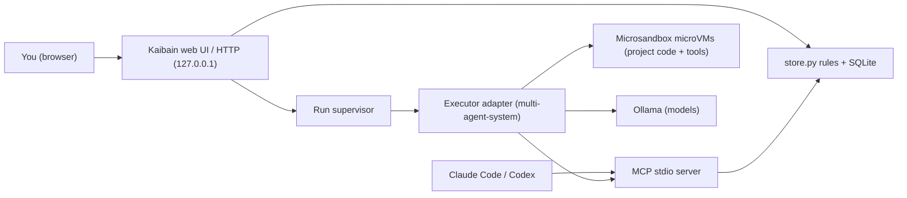

# Kaibain · agents native

[Русская версия](README.md) · [License: MIT](LICENSE) · [Security](SECURITY.md)

Kaibain is a local workspace where **built-in sandboxed AI agents plan and do the
work, and you set goals and accept results**. Claude Code and Codex can connect
as additional clients over MCP. Platform priority: macOS, then Windows.

> [!WARNING]
> **Experimental, pre-1.0 software.** Unit and scripted browser checks pass on
> Windows; macOS CI is configured but macOS platform acceptance is still open.
> Real autonomous LLM coding runs on non-trivial tasks currently **fail** more
> often than they succeed — see [docs/STATUS.md](docs/STATUS.md) and
> local run evidence (kept out of Git), including failures.
> Most detailed documentation is in Russian.

## What it does

1. **Projects** — save a Git repository profile: files to import, writable files,
   test command and acceptance criteria.
2. **Goals** — describe the desired result, context, constraints and an optional deadline.
3. **Run agents** — a coordinator and a developer appear on a live graph, decompose
   the goal into subtasks, edit files inside a **microVM**, run the tests and replay
   them in a fresh clean microVM.
4. **Review** — inspect the diff, test logs and report at `/reviews/<run-id>`, then
   accept or return the work with feedback (revisions reuse the same subtask).
5. **Apply** — a separate explicit action creates a local branch `kaibain/<run-id>`
   with one commit on top of the source commit. HEAD, index and working tree are
   untouched; nothing is merged or pushed.

There is **no manual mode**: no drag-and-drop, no manual status editing. The board
is for observing agents. Humans own goals, start/stop, acceptance and Apply;
agents own decomposition and task statuses. Agents can never accept a root goal.

Other features: goal dialogue (the coordinator can ask you questions and the run
parks until you answer), sealed checkpoints with explicit human-triggered recovery,
operator cleanup, live agent graph with phases/budgets/dependency links, calendar,
Spotlight search, light/dark themes and backup/restore.

## Architecture



- This repository: web app, MCP server, shared business rules
  (`src/kaibain/store.py`), run supervision, review/Apply, recovery, backup.
- The built-in executor (LangGraph orchestration, Microsandbox microVMs, model
  calls) lives in the separate sibling repository
  [multi-agent-system](https://github.com/m5tshift/multi-agent-system), expected
  at `../multi-agent-system`. Relative links to it in the docs assume that layout.
- Models run locally in [Ollama](https://ollama.com). No API keys, cloud services
  or accounts are required by Kaibain itself. Models are never downloaded automatically.

## Quick start

Requirements: Python 3.11+ (CI uses 3.14) and Git on `PATH`.

```sh
# macOS
python3 run.py start
python3 run.py status
python3 run.py stop
```

```powershell
# Windows
py run.py start
py run.py status
py run.py stop
```

`start` creates `.venv`, installs `requirements.txt`, writes a project `.mcp.json`
(Claude Code) and `.local/codex.toml` (Codex), and starts a hidden server. Wait
for `ok: true` in the JSON output; the URL is usually http://localhost:8765
(use `start --port 8766` if the port is busy). Logs: `.local/server.log`.
Foreground mode: `python run.py web`.

The server listens only on `127.0.0.1`, validates Host/Origin and rejects
cross-site requests. It is intended for **one trusted local user**.

### Built-in sandbox executor (optional)

Without an executor you can still use the UI and external MCP clients. To run
built-in agents, prepare the sibling repository from its own venv:

```sh
python -m pip install -r requirements-development.txt
python run_sandbox.py doctor
python run_sandbox.py prepare
python run_development_web.py --connect-web
```

This requires a working hypervisor, Microsandbox and locally installed Ollama
models (defaults: `qwen3:1.7b` coordinator, `qwen3:8b` developer). Use the
**Check environment** button in Settings for read-only readiness diagnostics.

### External clients: Claude Code and Codex

`run.py start` generates `.mcp.json` for Claude Code; for Codex it returns a
`codex_add_argv` array to register the server. Tools include `get_workspace`,
`list_tasks`, `get_task`, `create_task`, `update_task`, `set_task_status`,
`register_agent`, `heartbeat_agent`, `ask_question`, `submit_goal_result` and more.
Writes require `expected_version` (optimistic concurrency). Reports from external
clients are **self-reported** — connecting over MCP does not sandbox them.
See [examples/](examples) for configuration templates.

## Tests

```sh
python -m pip install -r requirements-dev.txt
python -m unittest discover -s tests -v
python -m playwright install chromium
python tests/browser_check.py   # plus the other tests/browser_*_check.py
```

Set `PLAYWRIGHT_CHANNEL=''` to use Playwright's Chromium instead of installed Edge
on Windows. MicroVM and real-model checks are opt-in and need the prepared sibling
runtime; see [CONTRIBUTING.md](CONTRIBUTING.md) and [README.md](README.md#проверки).

## Repository map

| Path | Purpose |
| --- | --- |
| `run.py` | launcher: `start`, `status`, `stop`, `web`, `mcp`, `backup`, `restore` |
| `src/kaibain/` | application (store, web, MCP, supervisor, review, recovery, backup) |
| `src/static/` | browser UI (no build step) |
| `tests/` | unit tests and Playwright browser checks |
| `docs/STATUS.md` | current status and handoff |
| `docs/evaluations/` | local run evidence, git-ignored (not published) |
| `AGENTS.md` | rules for coding agents working on this repository |

Machine-local state (`.venv`, `.local`, `.mcp.json`, `data`, `.agent-runs`) is
git-ignored and must not be copied between machines or operating systems.

## Contributing and license

Read [CONTRIBUTING.md](CONTRIBUTING.md) and [AGENTS.md](AGENTS.md) first.
Report vulnerabilities privately as described in [SECURITY.md](SECURITY.md).
Licensed under the [MIT License](LICENSE).
